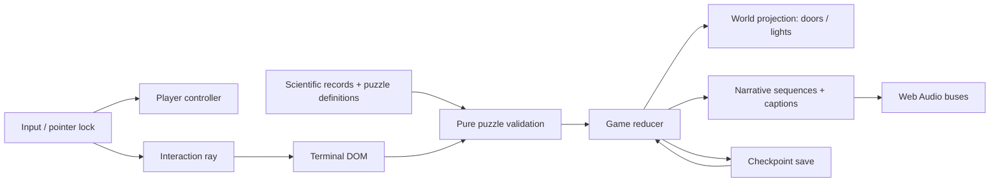

# ARCHITECTURE

## Contrato vigente del arco narrativo

Estados actuales: ARRIVAL → ARCHIVE_OPEN → OPPORTUNITY_RESTORED → CHAPTER_TWO → INSIGHT_RESTORED → READY_TO_PRESERVE → EPILOGUE → OBSERVATION → RESCUE → COMPLETE. `awakened` se guarda por separado y bloquea PZ-00 antes de la recuperación. Eventos explícitos: awakeningCompleted, chapterTwoStarted, monologueCompleted, observationEntered y rescueCompleted.

Se reutilizan reducer, proyección, save y validadores. El director en main.ts añade modos CINEMATIC e INTERACTING sin duplicar la lógica de respuestas. UI cinematográfica consume SceneBeat y reloj acumulado; el director aplica cámara/luz y avanza eventos únicamente al terminar/continuar/saltar la secuencia correspondiente. Ningún AnimationGroup de Blender desbloquea el juego.

Guardado contentVersion 2026-11-14.2: valida awakened y etapas; versiones antiguas se rechazan con explicación, sin migración inventada. EPILOGUE puede repetirse tras recarga; OBSERVATION vuelve al relay; RESCUE se puede reanudar junto al ventanal.

Nuevos módulos: player/hands.ts (viewmodel con clips y fallback), world/rescue.ts (actor y foco en 3D), audio/voice.ts (voz del navegador con captions). Manifest visual admite `hands` con ruta assets/models/player-hands.glb y `rescue` como modelo opcional. La colisión y las interacciones siguen independientes del arte. Los detalles v1 siguientes son históricos cuando contradigan este contrato.

V1.0 · Especificación, no código implementado. Todas las rutas y comandos de producción de este documento son futuros.

## Límites del sistema

Aplicación estática de un jugador, sin login, servidor de juego, API de IA ni tráfico de telemetría. Una escena 3D y una capa DOM. Los datos científicos revisados forman parte del bundle/archivos locales. La conectividad solo es necesaria para descargar el sitio y abrir fuentes externas opcionales.

## Organización prevista y propiedad

| Ruta | Responsabilidad | Escritor principal |
| --- | --- | --- |
| `src/main.ts`, `src/app/` | Arranque, errores y modos de aplicación | Codex |
| `src/engine/` | Engine, escena, render loop, resize y disposal | Codex |
| `src/player/`, `src/interaction/` | Movimiento, colisión, raycast, captura | Codex |
| `src/world/` | Construcción modular, proxies, puertas, luces | Codex |
| `src/game/` | Contratos, reducer, proyección de progreso | Codex |
| `src/puzzles/` | Validadores y adaptadores de puzzles | Codex |
| `src/ui/`, `src/audio/`, `src/save/` | UI funcional, mezclador y persistencia | Codex |
| `src/content/science/`, `src/content/narrative/`, `src/content/locales/` | Fichas, guion, pistas, captions | Claude, con revisión científica humana |
| `public/assets/`, `public/credits/` | Assets admitidos, avisos y créditos | Claude; Codex integra sin modificar archivos en paralelo |
| `tests/`, `scripts/`, configuración y lockfile | Pruebas, validación de contenido y build | Codex |

La división es una propuesta de trabajo; ambos agentes pueden revisar el otro subsistema. Solo existe un escritor por archivo. Contratos, integraciones y excepciones se coordinan como indica COLLABORATION_PLAN.

## Arranque y render

1. Mostrar interfaz accesible antes de inicializar el canvas. Comprobar WebGL 2.
2. Crear engine, escena y materiales; cargar/validar datos científicos y definiciones. Construir proxies antes de habilitar movimiento.
3. Cargar assets esenciales con errores explícitos. Imágenes tienen fallback textual; sonido opcional puede omitirse. Un fallo de geometría/control esencial ofrece reintento y evita una falsa pantalla de juego utilizable.
4. Leer guardado válido, derivar puertas/luz y ubicar jugador en checkpoint seguro. Abrir menú.
5. Un gesto en Enter archive solicita audio y captura; después activa el control.

Un render loop, un listener por evento de documento y un dueño de cada recurso. Resize actualiza canvas con DPR limitado; restart reinicia estado y proyección, sin crear otro engine. Dispose elimina listeners, buffers, nodos audio y objetos. No se registra el mismo efecto tras cada apertura del terminal.

## Jugador y colisiones

UniversalCamera solo gestiona orientación; quitar movimiento de teclado/gravedad automáticos para evitar control duplicado. Cuerpo invisible centrado a Y=0.85 m, elipsoide aproximado (0.30, 0.85, 0.30). Ojos a Y=1.65 m. La escena tiene colisiones habilitadas y proxies sólidos en muros, marcos, pedestales y puertas cerradas.

El núcleo tiene suelo plano continuo y altura fija: movimiento horizontal con `moveWithCollisions`, sin salto ni simulación de caída. No necesita motor de física o gravedad realista. Si posteriormente hay desniveles se requiere otro diseño y nuevas pruebas; no añadirlos silenciosamente. La [gravedad de cámara de Babylon](https://doc.babylonjs.com/features/featuresDeepDive/cameras/camera_collisions/) tiene una simplificación por frame y no debe confundirse con aceleración física.

Simulación a 60 pasos/s, desplazamiento = dirección normalizada ×1.8×dt. Acumulador con máximo cinco pasos por frame; tras pausa/foco se reinicia para no “recuperar” segundos de movimiento. El menor rendimiento puede causar ralentización al agotar ese límite, pero no un gran desplazamiento que atraviese una pared. Verificarlo bajo throttling.

Separar visibilidad, pickability y colisión: ocultar una malla no elimina su proxy; el cuerpo del jugador no se selecciona a sí mismo. Si el cuerpo queda fuera de límites autorizados, registrar el fallo y ofrecer/ejecutar recuperación al punto seguro; QA no considerará resuelto el defecto de colisión por ese rescate.

## Interacción y foco

Raycast desde el centro de cámara hasta 2.2 m. Incluir en la consulta objetos interactivos **y** proxies/meshes que bloqueen interacción. Si el impacto más cercano es una pared, no hay interacción, aunque un terminal exista detrás. No filtrar el raycast solo por interactuables.

Contrato `Interactable`: ID estable, etiqueta en inglés, estado de habilitación, acción de inspección y metadatos de oclusión. Un pulso de E genera una acción; mantenerla pulsada no dispara múltiples diálogos. Los interactuables persistentes no se destruyen al resolver.

Abrir UI: limpiar input, congelar movimiento, soltar captura y mover foco al panel. Diferenciar salida de captura esperada por abrir UI de pérdida inesperada. Cerrar UI usa un gesto explícito para recapturar o deja pausa. `pointerlockerror`, `pointerlockchange`, blur y pestaña oculta tienen rutas visibles de recuperación. No se necesita fullscreen ni iframe para jugar.

## Estado de aplicación y progreso

Modos de aplicación: `BOOT`, `MENU`, `PLAYING`, `TERMINAL`, `PAUSED`, `ENDING`, `COMPLETE`, `RECOVERY`, `UNSUPPORTED`. Solo PLAYING mueve el cuerpo. No son etapas narrativas ni deben guardarse como si fueran progreso.

Etapas monotónicas del relato:

| Etapa | Evento aceptado para avanzar | Checkpoint derivado tras avanzar |
| --- | --- | --- |
| `ARRIVAL` | PZ-00 correcto | `ARCHIVE_OPEN` → HUB (0,4) |
| `ARCHIVE_OPEN` | PZ-01 correcto | `INSIGHT_RESTORED` → INSIGHT (−9,6) |
| `INSIGHT_RESTORED` | PZ-02 correcto | `OPPORTUNITY_RESTORED` → OPPORTUNITY (9,6) |
| `OPPORTUNITY_RESTORED` | PZ-03 correcto | `READY_TO_PRESERVE` → RELAY (0,14.5) |
| `READY_TO_PRESERVE` | Confirmar y terminar/saltar presentación | `COMPLETE` → RELAY (0,14.5) |

ARRIVAL carga en AIRLOCK (0,−6). Las puertas y los booleanos de puzzle se derivan de la etapa; no se guardan copias independientes que puedan contradecirla. El reducer rechaza eventos fuera de orden, trata duplicados como no-op y nunca revoca una etapa por una respuesta errónea. Menú, ayudas, audio, idiomas y animaciones no alteran prerrequisitos.

Al entrar en ENDING desde READY_TO_PRESERVE, conservar checkpoint READY hasta recibir `presentationCompleted` o `skipPresentation`. Un botón Continue sigue disponible y un watchdog permite salir si una animación no acaba. El estado COMPLETE no depende de tener sonido o de un callback gráfico único.

## Contratos de datos

| Contrato | Campos mínimos | Invariante |
| --- | --- | --- |
| `ScientificRecord` | id, missionId, title, sourceUrl, sourceFields, retrievedAt, claimIds, credit, usageTerms, editorialSummary | Valores fuente separados del resumen; no ficción en sourceFields |
| `Claim` | id Fxx, statementEn, sourceIds, evidenceKind | Toda afirmación FACT tiene fuente revisada |
| `PuzzleDefinition` | id, prerequisiteStage, recordIds, fields/options, solutionClaimIds, hints, feedback | Todas las opciones/soluciones de GDD existen; no aleatoriedad esencial |
| `NarrativeBeat` | id Lxx, trigger, layer, caption, duration/continue, onceId | FICTION no obtiene etiqueta NASA |
| `AssetRecord` | id, path, sourceUrl, rights, credit, hash, derivedFrom, transforms, fallback | Todo archivo servido tiene procedencia y derechos admitidos |

Los datos se validan al desarrollar y al arrancar; no se añade una dependencia de schemas si unas funciones pequeñas bastan. El contenido se trata como inmutable. UI usa texto seguro, no HTML remoto. Las respuestas usan IDs estables y relaciones revisadas, no coincidencia aproximada de texto traducido.

## Puzzles y secuencias

Validación pura de respuestas sin Babylon o DOM; devuelve campos correctos/incorrectos y resultado. Antes de avanzar, el reducer comprueba etapa y puzzle. El mundo se sincroniza desde el nuevo estado de forma idempotente. La apertura visual puede animarse, pero la proyección sabe que la puerta debe terminar abierta.

Las secuencias narrativas tienen IDs de una sola ejecución y captions persistentes en el diario. Se encolan después de cerrar evidencia, no la interrumpen. No hay diálogo generado en ejecución ni necesidad de red. Los guiones no contienen código evaluable.

## Audio y recursos

Un AudioContext y buses master/ambience/effects; emisores asociados a transformaciones del mundo. Reanudar contexto tras gesto del jugador, capturar rechazo y mostrar opción de reintento. Pause/blur reduce o suspende audio; los sonidos de un solo uso no se repiten al recuperar foco. No reproducir dos ambientes tras restart.

Geometría procedural primero. Carga opcional GLB por loader modular, con collider propio. NASA y terceros se sirven desde el mismo origen con rutas relativas al base path Vite. No incrustar SoundCloud/YouTube ni depender de CORS de NASA. Las imágenes científicas mantienen una copia de su ficha/crédito aunque falle su archivo.

## Guardado y recuperación

Clave propuesta `vorax.save.v1`; settings separados en `vorax.settings.v1`. Payload pequeño: schemaVersion, contentVersion, storyStage, viewedRecordIds, seenBeatIds y savedAt. No persistir coordenadas arbitrarias, DOM, mallas, respuestas erróneas o nodos de audio.

Guardar tras cada etapa; restaurar de manera segura antes de habilitar movimiento. Validar tipos, enums, compatibilidad y prerrequisitos. Etapa inválida o versión desconocida: informar que no se pudo cargar progreso y ofrecer nueva sesión; migrar solo versiones con una regla probada. Un fallo de setItem mantiene el estado en memoria y no bloquea el juego. El almacenamiento privado/bloqueado y la pérdida de datos al cambiar origen son límites reconocidos, no sincronización de cuenta.

Reset borra solo claves de VØRAX y requiere la acción explícita de New game. Recenter usa el checkpoint de la etapa sin borrar progreso. Guardado se puede recortar si no supera las pruebas; la partida completa en una sesión sigue siendo obligatoria.

## Rendimiento y entrega

Compartir geometrías/materiales, acotar shadow casters, evitar creación de objetos por frame y congelar solo transformaciones realmente estáticas. No congelar puertas, cuerpo, luces o el relay animado. Sin físicas ni postprocesos pesados. Aplicar presupuestos ART_DIRECTION y medir QA_PLAN en hardware real.

Scripts previstos: `typecheck`, `test`, `validate:content`, `build`, `preview`, `test:e2e`. No existen todavía. Orden futuro: instalación reproducible → tipos/datos/unitarias → build → pruebas del build servido → revisión manual → despliegue → prueba anónima real. `preview` no es producción.

Host estático HTTPS, una ruta principal sin routing complejo, base path documentado. Archivos con hash de Vite pueden cachearse; HTML debe permitir recibir una versión nueva. No service worker en el núcleo para evitar builds antiguos. No secretos o claves en bundle.

Ante WebGL/context loss: pausar, conservar estado disponible y ofrecer recarga/checkpoint con mensaje. Ante falta de soporte: mostrar requisitos, referencias y demo si existe; eso no se cuenta como haber entregado el juego 3D solicitado. El build de producción no contiene mutadores de estado de QA ni inspector.

## R4 viewmodel implementation — 2026-11-15

`FirstPersonHands` loads the local `assets/models/player-hands.glb`, preserves the seven original clip names and adds Walk1.12s, Sprint.72s and Inspect1.4s. `setMotion`, `setInteractionTarget` and `setClearance` supply presentation inputs. Joint TRS channels sample on the game clock and blend with quaternion interpolation; pausing freezes both sampling and transition time. Source/instance meshes receive two restricted camera-local lights and no cabin fog. Gameplay keeps input, collision, interaction proxies and reducer authority; render meshes remain non-colliding/non-pickable. Prologue support uses the same camera trajectory and time phase as the authored clip. Delivery and validation are in CINEMATIC_OVERHAUL.md.

## PZ-02 optical projection prototype — 2026-11-15

`GameUI.showPuzzle('PZ-02')` delegates to an isolated optical reader in `ui.ts`; `hologram.css` affects only its classes. CSS perspective retains semantic DOM controls and source links. It reuses unchanged `record()` nodes, moving the figure into the right column and original text into the left. The reconstruction form persists while modes switch; radio names/values use the existing field/option IDs and call the same submit validator. No reducer/save/world/camera contract changed. The ordinary contextual hand interaction remains in `main.ts`. Wider rollout awaits user visual approval.

Approved continuation extends the same optical frame through `opticalFrame`, `archiveNavigation` and `reconstructionForm` helpers to other terminals/records/journal. `optical-system.css` styles shared views and narrative channels; `terminal.css` styles the visor only. Journal uses the existing unlockedRecords guard and actual RECTS to draw its labelled fictional map. No engine/state/save/scientific contract changed. The historical pending-approval note above was satisfied by the user.
